<div align="center">


# aws-analyzer

**Understand your AWS data from a SageMaker notebook.**

Readable reports on your buckets, tables, knowledge bases, functions, workflows, APIs, queries and queues:<br>
what's there, what it costs, and what to do next. Windows you click through. An agent you can just ask.

[](https://github.com/utkarsh5026/aws-analyzer/actions/workflows/ci.yml)
[](https://pypi.org/project/aws-analyzer/)
[](.github/workflows/ci.yml)
[](#why-aws-analyzer)
[](LICENSE)

**[📖 Read the guides](https://utkarsh5026.github.io/aws-analyzer/)** · [Get started](#get-started) · [Services](#services) · [See it](#see-it) ·
[Permissions](#permissions) · [Changelog](CHANGELOG.md)

</div>

<br>

<picture>
  <source media="(prefers-color-scheme: dark)" srcset="docs/images/overview-dark.webp">
  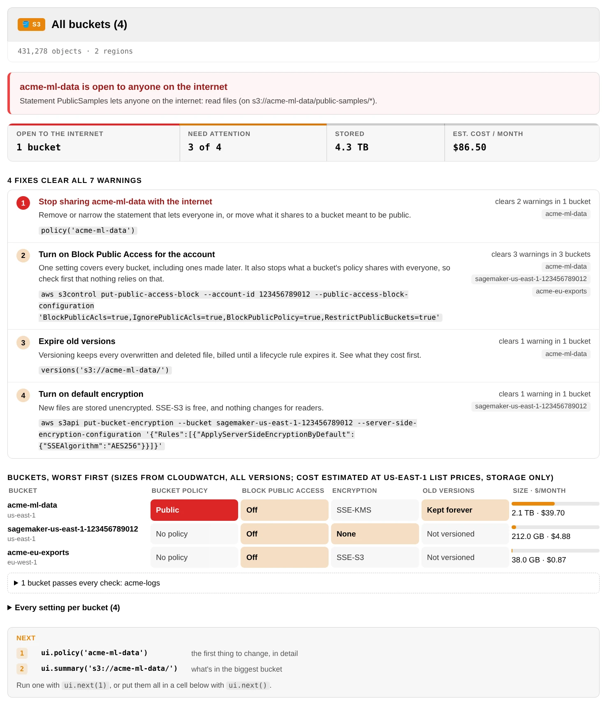
</picture>

<p align="center"><sub><code>ui.overview()</code>: what to fix first, the changes that clear every warning, and each bucket's risks, size and estimated monthly cost.</sub></p>

## Why aws-analyzer

<table>
<tr>
<td width="33%" valign="top">
<b>🧭 The answer first</b><br>
The few numbers that matter, then the rest in plain English: policies, lifecycle rules, settings. Raw JSON stays
folded away.
</td>
<td width="33%" valign="top">
<b>💵 Findings you can act on</b><br>
Each warning says what's wrong, what it costs ("$12.40/month") and the next step, with the call or command to copy.
</td>
<td width="33%" valign="top">
<b>🔒 Read-only</b><br>
Nothing writes to your account. Where a change would help, the report shows the command instead of running it.
</td>
</tr>
<tr>
<td width="33%" valign="top">
<b>🧾 Honest about cost</b><br>
Estimates are labelled, with the prices used. Expensive scans stop early and say what they read.
</td>
<td width="33%" valign="top">
<b>📦 One install</b><br>
<code>%pip install aws-analyzer</code> gives you every service and the agent. Only boto3 is needed for reports.
</td>
<td width="33%" valign="top">
<b>💬 Notes, not tracebacks</b><br>
A missing permission or package becomes a short note on how to fix it, and the rest of the report still renders.
</td>
</tr>
</table>

## Services

| Service | What it shows you | Docs |
| :------ | :---------------- | :--- |
|  **Amazon S3** | Every bucket's size, cost and risks; folders, search and previews of CSV, Parquet, JSON, Excel, PDF and Word; what you could save | [Guide](https://utkarsh5026.github.io/aws-analyzer/s3.html) · [Explorer](https://utkarsh5026.github.io/aws-analyzer/s3_explorer.html) |
|  **Amazon DynamoDB** | Every table's keys, size and cost; scans and queries as plain tables; the attributes items hold; the read units each report used | [Guide](https://utkarsh5026.github.io/aws-analyzer/dynamodb.html) · [Explorer](https://utkarsh5026.github.io/aws-analyzer/dynamodb_explorer.html) |
|  **Bedrock Knowledge Bases** | Settings in plain English, sync health, how each file was indexed; search and answers with every claim linked to its source | [Guide](https://utkarsh5026.github.io/aws-analyzer/bedrock_kb.html) · [Explorer](https://utkarsh5026.github.io/aws-analyzer/bedrock_kb_explorer.html) |
|  **Knowledge base chat** | A chat window with every RetrieveAndGenerate setting in reach; test a list of questions and see which setup does better | [Guide](https://utkarsh5026.github.io/aws-analyzer/bedrock_chat.html) |
|  **Amazon SageMaker** | The notebook you're in: cost, CPU, memory, disk, GPU; its Python environments; what's running and billing; why a job or pipeline failed | [Guide](https://utkarsh5026.github.io/aws-analyzer/sagemaker_env.html) |
|  **Amazon OpenSearch** | Every vector field in plain English; whether the graphs fit in memory; documents without a vector; nearest neighbours | [Guide](https://utkarsh5026.github.io/aws-analyzer/opensearch.html) · [Explorer](https://utkarsh5026.github.io/aws-analyzer/opensearch_explorer.html) |
|  **AWS Lambda** | Every function's triggers, calls, errors and cost; where its callers' limits clash with its settings; errors grouped by cause; cold starts and memory; logs run by run; how its code works | [Guide](https://utkarsh5026.github.io/aws-analyzer/lambda_functions.html) · [Explorer](https://utkarsh5026.github.io/aws-analyzer/lambda_explorer.html) |
|  **AWS Step Functions** | Where and why executions fail; one execution step by step, with the Lambda lines of the run that broke it | [Guide](https://utkarsh5026.github.io/aws-analyzer/stepfunctions.html) · [Explorer](https://utkarsh5026.github.io/aws-analyzer/stepfunctions_explorer.html) |
|  **Amazon API Gateway** | Requests, errors, latency and cost per API; routes anyone can call; failed calls from the access log, and the Lambda run behind each | [Guide](https://utkarsh5026.github.io/aws-analyzer/apigateway.html) · [Explorer](https://utkarsh5026.github.io/aws-analyzer/apigateway_explorer.html) |
|  **Amazon Athena** | What past queries scanned and cost; why they failed, with the fix; tables whose folder is empty or gone; failed crawlers | [Guide](https://utkarsh5026.github.io/aws-analyzer/athena.html) · [Explorer](https://utkarsh5026.github.io/aws-analyzer/athena_explorer.html) |
|  **SQS, SNS and EventBridge** | Where a message went, hop by hop; queues backing up; dead-letter queues; the policy or key that keeps a sender out | [Guide](https://utkarsh5026.github.io/aws-analyzer/messaging.html) · [Explorer](https://utkarsh5026.github.io/aws-analyzer/messaging_explorer.html) |
|  **Ask in plain English** | An agent that answers "Which Lambda failed last night?" from the same read-only tools, says what it checked, and on the model you pick | [Guide](https://utkarsh5026.github.io/aws-analyzer/agent.html) |

Each guide walks through a service with screenshots and a short video tour: setting up, every command, and a
ready-made IAM policy.

## Get started

**1. Install it**, in a notebook cell:

```python
%pip install aws-analyzer             # every service and the agent (Python 3.11+)
%pip install "aws-analyzer[all]"      # plus pandas, pyarrow, the PDF and Excel readers, progress bars
```

**2. Look around.** It uses the notebook's IAM role, so there's nothing to configure:

```python
from aws_analyzer import S3View, LambdaView, AgentView

ui = S3View()
ui.help()                             # every command, grouped by task
ui.overview()                         # every bucket: what to fix first, size, monthly cost

LambdaView().explore()                # a window: every function, its logs run by run, errors and code
AgentView().ask("Which Lambda failed last night?")
```

**3. Or open it in a browser tab**, with more room. In JupyterLab's terminal (**File → New → Terminal**):

```bash
aws-analyzer serve                    # or: python -m aws_analyzer serve
#   Open: https://<notebook>.notebook.<region>.sagemaker.aws/proxy/8765/?token=...
```

Open the link it prints: every service's read-only commands, a form for each, the same reports as in a cell, next
steps you run with a click and Ctrl K to find a command. It goes through JupyterLab's own proxy, behind the notebook's
sign-in, and stops with Ctrl+C. The [browser guide](https://utkarsh5026.github.io/aws-analyzer/browser.html) has the
details.

Every report ends with **⚙ Ran with**: the options its command used, defaults included, and other ways to run it
to copy (`ui.performance('etl', since='7d')`), so you learn a command's options without opening `help()`.

Every service has a View (`DynamoDBView`, `BedrockKBView`, `SageMakerView`, `OpenSearchView`, `StepFunctionsView`,
`APIGatewayView`, `AthenaView`, `MessagingView`, ...), and each View's `.core` is the analyzer behind it, which returns
plain Python data instead of a report.

> [!TIP]
> [`notebooks/aws_analyzer_commands.ipynb`](notebooks/aws_analyzer_commands.ipynb) has every command of every service
> in a cell of its own: fill in your names once at the top, then run any cell.

<details>
<summary><b>More</b>: no internet in the notebook, another profile or region, your time zone, themes</summary>

<br>

```python
ui = S3View(S3Analyzer(profile="dev", region="eu-west-1"))   # another AWS profile or region
ui = S3View(mode="text", max_rows=0)                          # plain text, every row

from aws_analyzer import set_timezone, set_theme
set_timezone("Asia/Kolkata")          # times in your zone (or AWS_ANALYZER_TZ)
set_theme("soft")                     # console, soft, editorial, brand or classic (or AWS_ANALYZER_THEME)
```

A notebook without internet access can install from a bucket: `pip download aws-analyzer --no-deps -d wheels` on a
machine that has it, copy `wheels/` to S3, then `%pip install --no-index --find-links wheels aws-analyzer` in the
notebook. The [guides](https://utkarsh5026.github.io/aws-analyzer/) cover each option in full.

</details>

## See it

<table>
<tr>
<td width="50%" valign="top">

<b>S3 explorer</b>

<picture>
  <source media="(prefers-color-scheme: dark)" srcset="docs/images/explorer-tour-dark.webp">
  
</picture>

<sub><code>S3Explorer()</code>: buckets to a Parquet file's first rows, one click at a time.</sub>

</td>
<td width="50%" valign="top">

<b>S3 preview</b>

<picture>
  <source media="(prefers-color-scheme: dark)" srcset="docs/images/preview-parquet-dark.webp">
  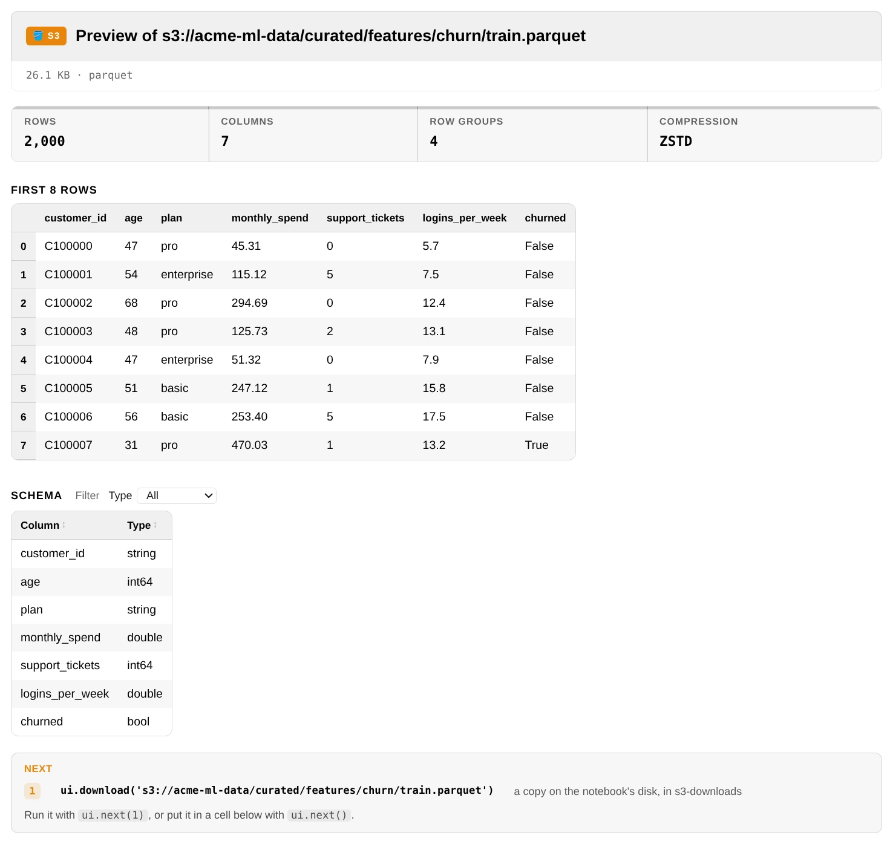
</picture>

<sub><code>ui.preview()</code>: a Parquet file's counts, first rows and schema.</sub>

</td>
</tr>
<tr>
<td width="50%" valign="top">

<b>DynamoDB table</b>

<picture>
  <source media="(prefers-color-scheme: dark)" srcset="docs/images/dynamodb-table-info-dark.webp">
  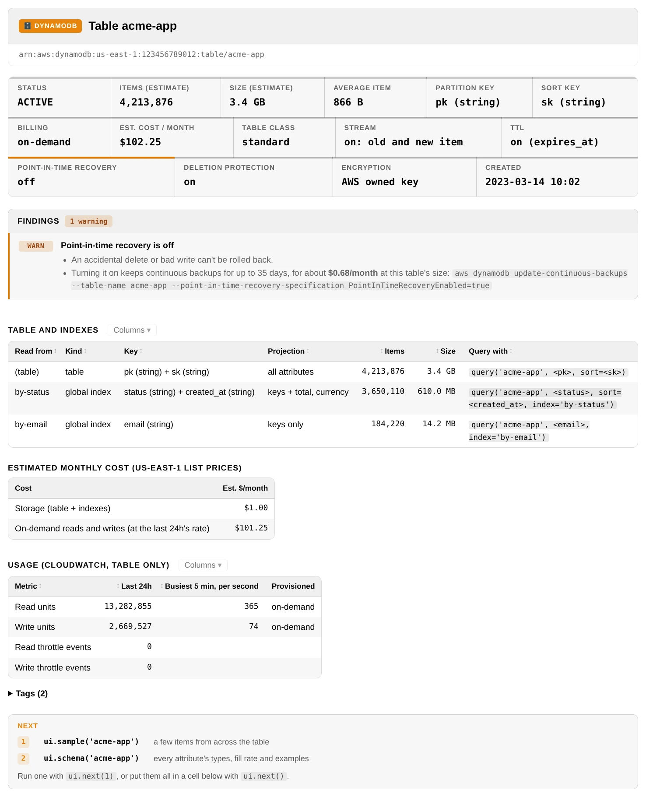
</picture>

<sub><code>ui.table_info("acme-app")</code>: keys, indexes, cost, and the fix for what's off.</sub>

</td>
<td width="50%" valign="top">

<b>DynamoDB scan</b>

<picture>
  <source media="(prefers-color-scheme: dark)" srcset="docs/images/dynamodb-scan-filter-dark.webp">
  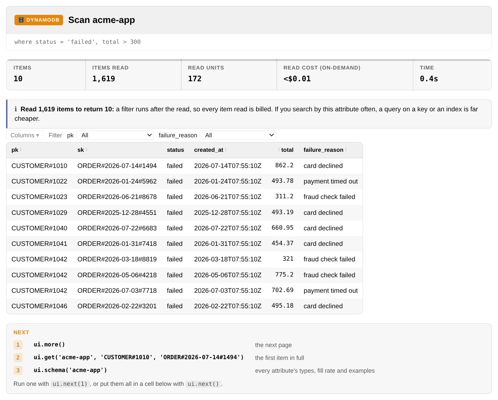
</picture>

<sub><code>ui.scan(where=...)</code>: the items, what the read cost, and why a query is cheaper.</sub>

</td>
</tr>
<tr>
<td width="50%" valign="top">

<b>Knowledge base answer</b>

<picture>
  <source media="(prefers-color-scheme: dark)" srcset="docs/images/bedrock-ask-dark.webp">
  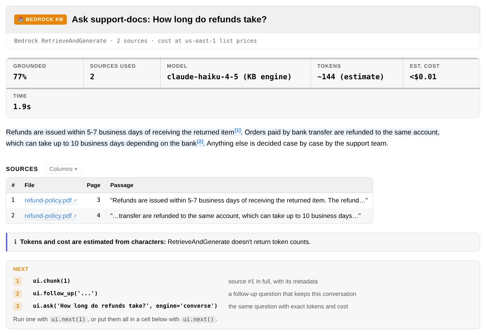
</picture>

<sub><code>ui.ask("How long do refunds take?")</code>: cited answer, 77% grounded.</sub>

</td>
<td width="50%" valign="top">

<b>Knowledge base explorer</b>

<picture>
  <source media="(prefers-color-scheme: dark)" srcset="docs/images/kb-explorer-tour-dark.webp">
  
</picture>

<sub><code>explore("support-docs")</code>: how a file was indexed, and whether a question finds it.</sub>

</td>
</tr>
<tr>
<td width="50%" valign="top">

<b>Knowledge base chat</b>

<picture>
  <source media="(prefers-color-scheme: dark)" srcset="docs/images/chat-tour-dark.webp">
  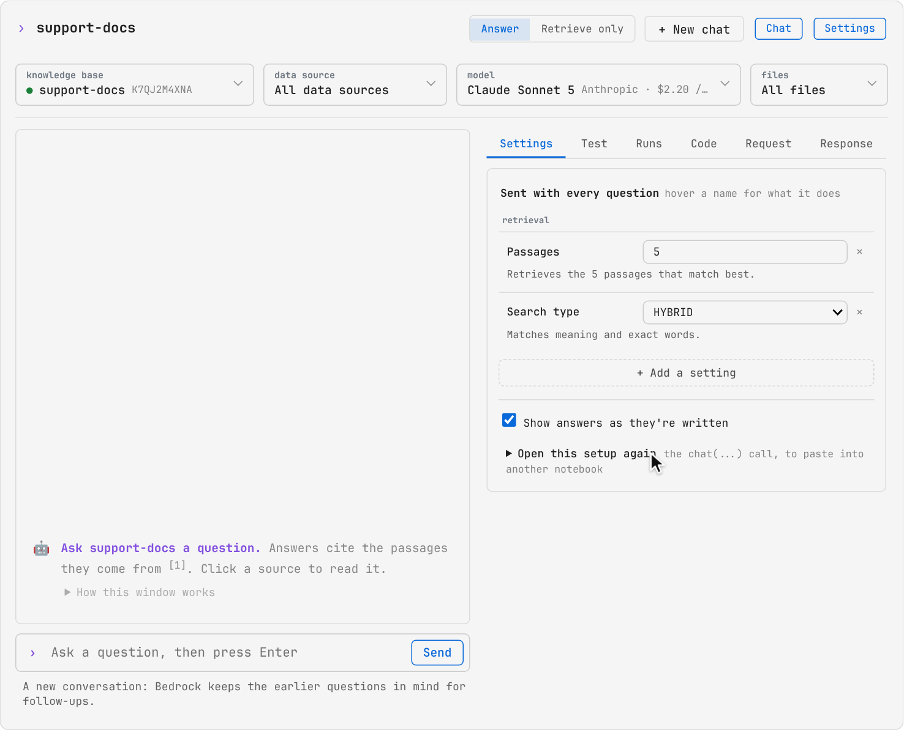
</picture>

<sub><code>chat("support-docs")</code>: ask, read the sources, run test questions.</sub>

</td>
<td width="50%" valign="top">

<b>SageMaker notebook</b>

<picture>
  <source media="(prefers-color-scheme: dark)" srcset="docs/images/sagemaker-instance-dark.webp">
  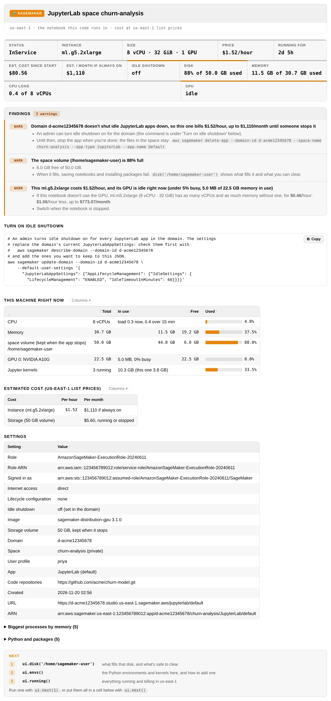
</picture>

<sub><code>ui.instance()</code>: about $80 spent so far on a GPU that sits idle.</sub>

</td>
</tr>
<tr>
<td width="50%" valign="top">

<b>OpenSearch index</b>

<picture>
  <source media="(prefers-color-scheme: dark)" srcset="docs/images/opensearch-index-info-dark.webp">
  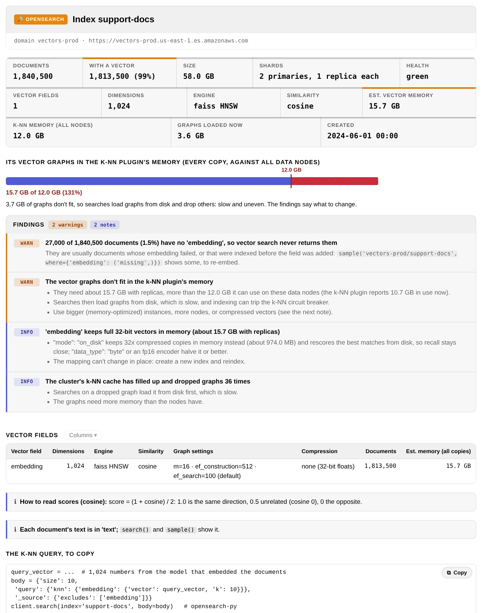
</picture>

<sub><code>ui.index_info(...)</code>: 27,000 documents without a vector, graphs that don't fit.</sub>

</td>
<td width="50%" valign="top">

<b>Lambda functions</b>

<picture>
  <source media="(prefers-color-scheme: dark)" srcset="docs/images/lambda-functions-dark.webp">
  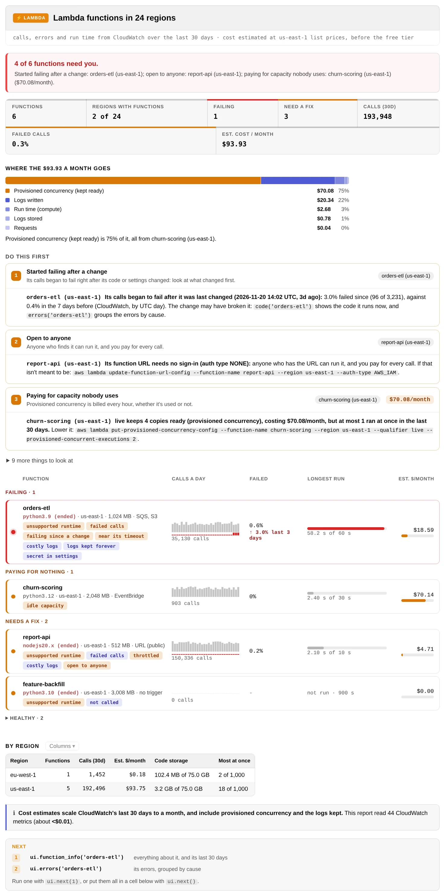
</picture>

<sub><code>ui.functions(regions="all")</code>: what's failing, what's open, what's wasted.</sub>

</td>
</tr>
<tr>
<td width="50%" valign="top">

<b>Lambda explorer</b>

<picture>
  <source media="(prefers-color-scheme: dark)" srcset="docs/images/lambda-explorer-tour-dark.webp">
  
</picture>

<sub><code>explore()</code>: a failed run's lines, a log search, errors by cause.</sub>

</td>
<td width="50%" valign="top">

<b>Step Functions explorer</b>

<picture>
  <source media="(prefers-color-scheme: dark)" srcset="docs/images/sfn-explorer-tour-dark.webp">
  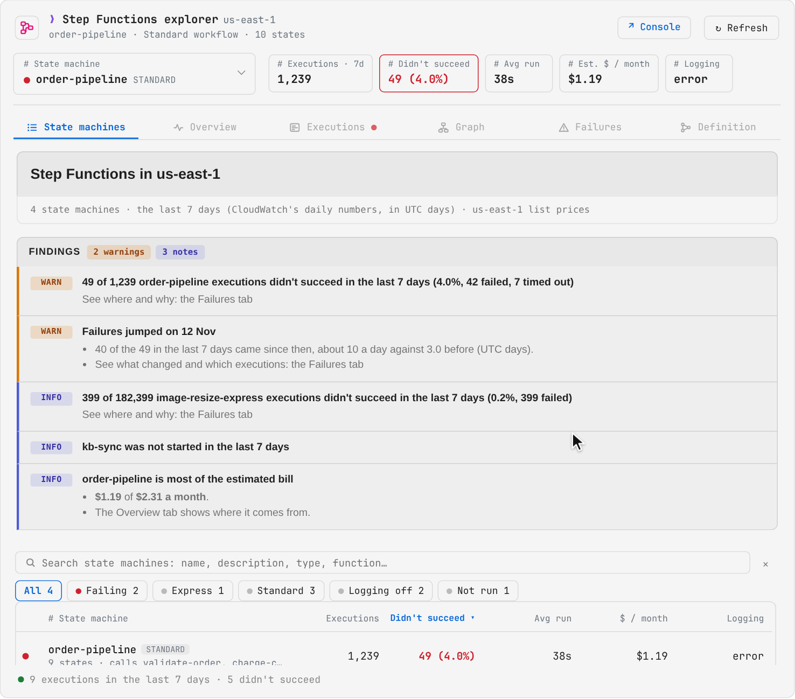
</picture>

<sub><code>explore()</code>: the step that broke, and where it sits in the graph.</sub>

</td>
</tr>
<tr>
<td width="50%" valign="top">

<b>API Gateway explorer</b>

<picture>
  <source media="(prefers-color-scheme: dark)" srcset="docs/images/apigw-explorer-tour-dark.webp">
  
</picture>

<sub><code>explore()</code>: a failed call, where its 29 seconds went, the Lambda run behind it.</sub>

</td>
<td width="50%" valign="top">

<b>Messaging explorer</b>

<picture>
  <source media="(prefers-color-scheme: dark)" srcset="docs/images/msg-explorer-tour-dark.webp">
  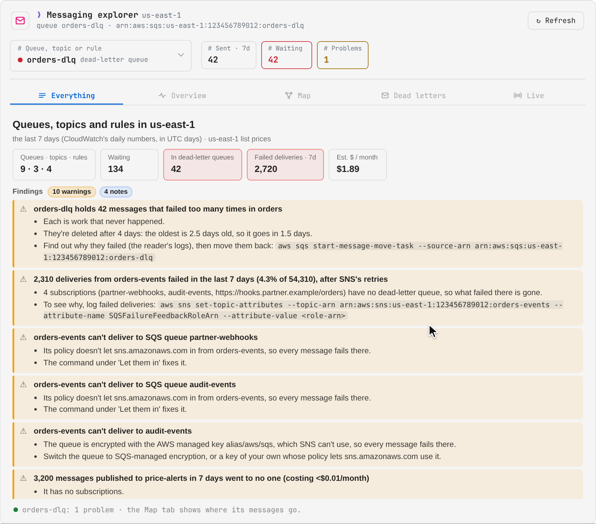
</picture>

<sub><code>msg.explore()</code>: what failed, where messages go, a queue draining live.</sub>

</td>
</tr>
<tr>
<td width="50%" valign="top">

<b>Agent chat</b>

<picture>
  <source media="(prefers-color-scheme: dark)" srcset="docs/images/agent-chat-tour-dark.webp">
  
</picture>

<sub><code>agent.chat()</code>: the plan ticked off as each read-only tool runs, then the answer.</sub>

</td>
<td width="50%"></td>
</tr>
</table>

## Permissions

Everything is read-only, but for `lambda:InvokeFunction`, which only Lambda's `invoke()` uses. Grant what you need;
anything you can't read shows up as a note instead of an error. Each guide has a ready-made IAM policy (for example
[Lambda's](https://utkarsh5026.github.io/aws-analyzer/lambda_functions.html#permissions)).

<details>
<summary><b>IAM permissions</b> by service</summary>

<br>

| Service | Permissions |
| :------ | :---------- |
| **Amazon S3** | `s3:ListAllMyBuckets`, `s3:GetBucketLocation`, `s3:ListBucket`, `s3:ListBucketVersions`, `s3:ListBucketMultipartUploads`, `s3:ListMultipartUploadParts`, `s3:GetObject`, `s3:GetObjectTagging`, the bucket settings (`s3:GetBucket*`: `s3:GetBucketVersioning`, `s3:GetBucketPolicy`, `s3:GetBucketPolicyStatus`, `s3:GetBucketPublicAccessBlock`, `s3:GetBucketOwnershipControls`, `s3:GetBucketObjectLockConfiguration`, `s3:GetBucketLogging`, `s3:GetBucketTagging`, `s3:GetBucketNotification`, with `s3:GetLifecycleConfiguration`, `s3:GetReplicationConfiguration`, `s3:GetEncryptionConfiguration`, `s3:GetInventoryConfiguration`), `s3:GetAccountPublicAccessBlock`, `cloudwatch:ListMetrics`, `cloudwatch:GetMetricData` |
| **Amazon DynamoDB** | `dynamodb:ListTables`, `dynamodb:DescribeTable`, `dynamodb:DescribeTimeToLive`, `dynamodb:DescribeContinuousBackups`, `dynamodb:ListTagsOfResource`, `dynamodb:Scan`, `dynamodb:Query`, `dynamodb:GetItem`, `dynamodb:PartiQLSelect`, `cloudwatch:GetMetricData`; `kms:Decrypt` for a table encrypted with your own key |
| **Bedrock Knowledge Bases and chat** | `bedrock:ListKnowledgeBases`, `bedrock:GetKnowledgeBase`, `bedrock:ListDataSources`, `bedrock:GetDataSource`, `bedrock:ListIngestionJobs`, `bedrock:GetIngestionJob`, `bedrock:ListKnowledgeBaseDocuments`, `bedrock:GetKnowledgeBaseDocuments`, `bedrock:ListTagsForResource`, `bedrock:Retrieve`, `bedrock:RetrieveAndGenerate`, `bedrock:InvokeModel` (the answering model), `bedrock:ListFoundationModels`, `bedrock:ListInferenceProfiles`, `s3:ListBucket` and `s3:GetObject` on the data sources' buckets |
| **Amazon SageMaker** | `sagemaker:DescribeNotebookInstance`, `sagemaker:DescribeNotebookInstanceLifecycleConfig`, `sagemaker:ListNotebookInstances`, `sagemaker:ListDomains`, `sagemaker:DescribeDomain`, `sagemaker:DescribeUserProfile`, `sagemaker:ListSpaces`, `sagemaker:DescribeSpace`, `sagemaker:ListApps`, `sagemaker:DescribeApp`, `sagemaker:ListEndpoints`, `sagemaker:DescribeEndpoint`, `sagemaker:DescribeEndpointConfig`, `sagemaker:ListTrainingJobs`, `sagemaker:DescribeTrainingJob`, `sagemaker:ListProcessingJobs`, `sagemaker:DescribeProcessingJob`, `sagemaker:ListPipelines`, `sagemaker:ListPipelineExecutions`, `sagemaker:DescribePipelineExecution`, `sagemaker:DescribePipelineDefinitionForExecution`, `sagemaker:ListPipelineExecutionSteps`, `cloudwatch:GetMetricData`, `logs:DescribeLogStreams`, `logs:GetLogEvents`, `cloudtrail:LookupEvents` |
| **Amazon OpenSearch** | `es:ListDomainNames`, `es:DescribeDomains`, `es:DescribeDomain`, `es:ESHttpGet`, `es:ESHttpPost` (to `_search` and `_count` only), `aoss:ListCollections`, `aoss:BatchGetCollection`, `aoss:ListSecurityPolicies`, `aoss:GetSecurityPolicy`, `aoss:GetAccountSettings`, `aoss:APIAccessAll` with a data access policy allowing `aoss:DescribeIndex` and `aoss:ReadDocument`, `cloudwatch:GetMetricData`, `bedrock:InvokeModel` (to embed a question) |
| **AWS Lambda** | `lambda:ListFunctions`, `lambda:GetFunction`, `lambda:GetPolicy`, `lambda:ListEventSourceMappings`, `lambda:GetFunctionUrlConfig`, `lambda:GetFunctionEventInvokeConfig`, `lambda:ListVersionsByFunction`, `lambda:ListAliases`, `lambda:ListProvisionedConcurrencyConfigs`, `lambda:GetRuntimeManagementConfig`, `lambda:GetAccountSettings`, `cloudwatch:GetMetricData`, `logs:DescribeLogGroups`, `logs:DescribeLogStreams`, `logs:FilterLogEvents`, `ec2:DescribeRegions` (for `regions="all"`), `sqs:GetQueueUrl`, `sqs:GetQueueAttributes`, `elasticloadbalancing:DescribeTargetGroups`, `elasticloadbalancing:DescribeLoadBalancerAttributes`, `apigateway:GET`; and `lambda:InvokeFunction`, only for `invoke()` |
| **AWS Step Functions** | `states:ListStateMachines`, `states:DescribeStateMachine`, `states:ListExecutions`, `states:DescribeExecution`, `states:GetExecutionHistory`, `states:DescribeStateMachineForExecution`, `cloudwatch:GetMetricData`, `logs:FilterLogEvents`, `lambda:GetFunction`, `lambda:ListVersionsByFunction`, `lambda:GetAccountSettings` |
| **Amazon API Gateway** | `apigateway:GET` (IAM's one permission for every API Gateway read), `cloudwatch:GetMetricData`, `logs:FilterLogEvents`, `lambda:GetFunction` |
| **Amazon Athena** | `athena:ListWorkGroups`, `athena:GetWorkGroup`, `athena:ListQueryExecutions`, `athena:BatchGetQueryExecution`, `athena:GetQueryExecution`, `athena:GetQueryRuntimeStatistics`, `athena:GetQueryResults`, `glue:GetDatabases`, `glue:GetDatabase`, `glue:GetTables`, `glue:GetTable`, `glue:GetPartitions`, `glue:GetCrawlers`, `glue:GetCrawlerMetrics`, `s3:ListBucket`, `s3:GetObject` (saved results) |
| **SQS, SNS and EventBridge** | `sqs:ListQueues`, `sqs:GetQueueAttributes`, `sqs:GetQueueUrl`, `sqs:ListDeadLetterSourceQueues`, `sns:ListTopics`, `sns:GetTopicAttributes`, `sns:ListSubscriptions`, `sns:ListSubscriptionsByTopic`, `sns:GetSubscriptionAttributes`, `events:ListEventBuses`, `events:ListRules`, `events:DescribeRule`, `events:ListTargetsByRule`, `events:ListRuleNamesByTarget`, `events:ListArchives`, `cloudwatch:GetMetricData`, `lambda:ListEventSourceMappings`, `lambda:GetFunctionConfiguration`, `lambda:GetPolicy`; never `sqs:ReceiveMessage` |
| **Ask in plain English** | The permissions above for the services it reads, plus `cloudwatch:ListMetrics`, `cloudwatch:DescribeAlarmsForMetric` and `cloudwatch:DescribeAlarms`; with a model on Bedrock, `bedrock:InvokeModel`, `bedrock:ListFoundationModels`, `bedrock:ListInferenceProfiles` and `bedrock:GetInferenceProfile` |

`sts:GetCallerIdentity` needs no permission.

</details>

## Development

Issues and pull requests are welcome: [CONTRIBUTING.md](CONTRIBUTING.md) explains the set-up and the rules the code
follows, and [SECURITY.md](SECURITY.md) how to report a vulnerability privately.

```bash
pip install -r requirements-dev.txt    # pinned versions
python -m pytest                       # every test, against moto: no AWS account needed
ruff check .                           # lint
mkdocs serve                           # the guide site, from docs/ (pip install -r requirements-docs.txt)
```

## License

[Apache License 2.0](LICENSE).

The service icons are from AWS's [Architecture Icons](https://aws.amazon.com/architecture/icons/), unchanged. AWS and
the AWS service names are trademarks of Amazon.com, Inc. or its affiliates; this project isn't made or endorsed by AWS.
